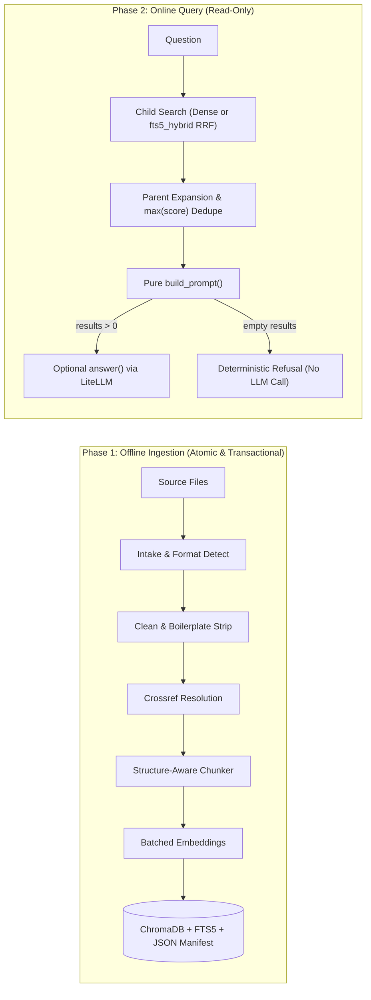

# docpipe-maestro

[](https://github.com/ivnmoreno/docpipe-maestro/actions/workflows/ci.yml)
[](https://www.python.org/downloads/)
[](https://opensource.org/licenses/MIT)
[](https://github.com/astral-sh/ruff)
[](https://mypy-lang.org/)

> **"docpipe-maestro is a minimal RAG pipeline: it ingests any document, chunks it correctly, embeds it, stores it, retrieves the right sections, and optionally generates a grounded answer. It is the engine — not the app, not the framework."**

`docpipe-maestro` is a provider-agnostic, structure-aware Python RAG (Retrieval-Augmented Generation) pipeline library and `docpipe-maestro` CLI. It solves the data-preparation and retrieval failure modes common in standard fixed-size chunkers: preserving document hierarchy, refusing to split legal or policy clauses mid-sentence, resolving intra-document cross-references, and guaranteeing that policy exceptions always stay attached to their rules.

---

## Table of Contents

- [Why docpipe-maestro?](#why-docpipe-maestro)
- [60-Second Quickstart](#60-second-quickstart)
- [Key Architecture & Core Concepts](#key-architecture--core-concepts)
- [Supported Formats & Limitations](#supported-formats--limitations)
- [Installation Guide](#installation-guide)
  - [Core Install](#core-install)
  - [Optional Extras](#optional-extras)
  - [Development Setup](#development-setup)
- [Configuration Guide](#configuration-guide)
  - [1. Local Execution (Default: Zero Cloud Accounts Required)](#1-local-execution-default-zero-cloud-accounts-required)
  - [2. Cloud Provider API Keys](#2-cloud-provider-api-keys)
  - [3. Local Persistence Storage Directory](#3-local-persistence-storage-directory)
  - [4. CLI Configuration File (`docpipe.toml`)](#4-cli-configuration-file-docpipetoml)
  - [5. Chunking Profiles (`DEFAULT`, `POLICY`, and Custom Profiles)](#5-chunking-profiles-default-policy-and-custom-profiles)
- [Quickstart: CLI Usage Guide](#quickstart-cli-usage-guide)
  - [1. Ingest Documents (`docpipe-maestro ingest`)](#1-ingest-documents-docpipe-maestro-ingest)
  - [2. Keep Collections in Sync (`docpipe-maestro sync`)](#2-keep-collections-in-sync-docpipe-maestro-sync)
  - [3. Inspect Collection Status (`docpipe-maestro status`)](#3-inspect-collection-status-docpipe-maestro-status)
  - [4. Remove a Source Document (`docpipe-maestro remove`)](#4-remove-a-source-document-docpipe-maestro-remove)
  - [5. Migrate Embedding Models (`docpipe-maestro reindex`)](#5-migrate-embedding-models-docpipe-maestro-reindex)
  - [6. Semantic Search Without an LLM (`docpipe-maestro query`)](#6-semantic-search-without-an-llm-docpipe-maestro-query)
  - [7. Grounded Question Answering (`docpipe-maestro ask`)](#7-grounded-question-answering-docpipe-maestro-ask)
- [Python Library API Guide](#python-library-api-guide)
  - [Phase 1: Ingestion & Lifecycle Workflow](#phase-1-ingestion--lifecycle-workflow)
  - [Phase 2: Semantic Retrieval & Grounded RAG Workflow](#phase-2-semantic-retrieval--grounded-rag-workflow)
  - [Core Data Shapes & Exceptions](#core-data-shapes--exceptions)
- [Security, Privacy & Grounding Notes](#security-privacy--grounding-notes)
- [Safety & Verification](#safety--verification)
- [Repository Structure](#repository-structure)
- [Contributing](#contributing)
- [Documentation](#documentation)
- [License](#license)

---

## Why docpipe-maestro?

| Common RAG Failure Mode | How `docpipe-maestro` Solves It |
|---|---|
| **Orphaned exceptions** (*"20 days leave"* retrieved without *"except probationary hires"*) | **Parent-child retrieval** searches fine-grained child chunks and returns deduplicated full parent sections, enforced by a mandatory Reverse Safety Gate (`tests/test_reverse_safety.py`). |
| **Broken intra-document references** (*"subject to Section 4.2"* without knowing what Section 4.2 says) | **`POLICY` cross-reference resolution** appends cycle-safe `[Crossref ...]` excerpts directly onto referring sections during ingestion. |
| **Orphaned vectors when files shrink or change** | **Transactional `doc_version` staging** writes new chunks, flips the JSON manifest atomically, and deletes stale versions afterward. Failed runs leave the prior version intact. |
| **Silent embedding vector-space corruption** | **Manifest model lock** pins each collection to one `embed_model` and raises `ModelMismatchError` unless migrated explicitly via `reindex`. |
| **Hallucinations when nothing relevant matches** | **Deterministic empty-context refusal** short-circuits before calling the LLM whenever `retrieve()` returns no chunks above `--threshold`. |

---

## 60-Second Quickstart

Run an entirely local pipeline using [Ollama](https://ollama.com/) (`nomic-embed-text` + `llama3.2`):

```bash
# 1. Install with all format parsers (from GitHub until published to PyPI)
pip install "docpipe-maestro[all] @ git+https://github.com/ivnmoreno/docpipe-maestro.git"
# Once published on PyPI: pip install "docpipe-maestro[all]"

# 2. Pull local Ollama models (one-time)
ollama pull nomic-embed-text
ollama pull llama3.2

# 3. Ingest a folder of policies and ask a grounded question
docpipe-maestro ingest ./policies --profile POLICY --collection handbook
docpipe-maestro ask "When are employees not entitled to overtime?" --collection handbook --threshold 0.35
```

*(Running from a cloned source repository? Prefix CLI commands with `uv run docpipe-maestro ...` or `uv run python -m docpipe_maestro ...`.)*

---

## Key Architecture & Core Concepts



1. **Two-Phase Separation**:
   - **Phase 1 (Offline Ingestion)**: Files $\to$ Parse $\to$ Clean $\to$ Cross-Reference Resolution $\to$ Structure-Aware Chunking $\to$ Embeddings $\to$ Vector Database. Correctness and crash safety matter.
   - **Phase 2 (Online Query)**: Question $\to$ Embed $\to$ Retrieve (Match Children, Return Deduplicated Parents) $\to$ Build Prompt $\to$ Optional Grounded LLM Generation. Read-only and low-latency.
2. **Search Small, Return Big (Parent-Child Retrieval)**:
   - Small **child chunks** (individual clauses/paragraphs prefixed with `[Source: ... | Section: ...]`) are embedded and searched for high precision.
   - Large **parent sections** (complete contextual sections) are stored with zero-vector placeholders and returned to the prompt.
3. **Exception Preservation & Reverse Safety Gate**:
   - In policy and legal documents, a rule without its exception is actively misleading (e.g., *"Employees receive 20 days leave"* without *"unless probationary"*). In `POLICY` profile, clauses are kept intact even when exceeding target chunk size, and parent sections ensure exceptions always accompany their rules.
4. **Crash-Safe Transactional Synchronization**:
   - Ingestion maintains an atomic database-collocated manifest (`.docpipe/manifests/<collection>.json`) tracking `sha256` content hashes, `mtime`, and `doc_version` prefixes.
   - Modifying a document performs staged delete-then-reinsert, preventing orphaned clauses when documents shrink.
5. **Embedding Model Lock**:
   - The manifest locks the collection to the embedding model used during ingestion. Attempting to ingest or query with a different model raises `ModelMismatchError` rather than silently mixing incompatible vector spaces. Model migration is handled cleanly via `reindex`.

---

## Supported Formats & Limitations

| Format | Extensions | Structural & Content Extraction | Extra Required |
|---|---|---|---|
| **Markdown** | `.md`, `.markdown` | ATX headings (`#`–`######`), code fence awareness (` ``` ` / `~~~` ignores `# comments`) | Core install |
| **Plain Text** | `.txt` | Heuristic `Section` / `Article` / `Chapter` / `Part` and numbered headings | Core install |
| **HTML** | `.html`, `.htm` | `<h1–h6>` headings, paragraphs, lists, tables (` \| `), strips `<script>`/`<style>`/`<nav>`/`<footer>`/`<noscript>` | `[html]` (`beautifulsoup4`) |
| **Word** | `.docx` | Word `Heading 1`–`Heading 6` styles, paragraphs, tables (` \| `) | `[docx]` (`python-docx`) |
| **PDF** | `.pdf` | Per-page text, 1-based page numbers, multi-page active heading carryover, boilerplate header/footer stripping | `[pdf]` (`pypdf`) |

- **Extensionless files**: `detect_format()` inspects the first 4 KiB for `%PDF-`, ZIP `word/document.xml`, HTML root tags (`<!doctype html` / `<html`), Markdown headings, or valid UTF-8 text.
- **Current scope & limitations**:
  - Image-only / scanned PDFs without an embedded text layer yield empty text (OCR is outside v0.1 scope).
  - Legacy binary `.doc` files are not supported (`.docx` only).
  - `docpipe-maestro` is a library and CLI engine — it deliberately excludes web servers, auth layers, streaming UIs, and multi-tenant isolation.

---

## Installation Guide

`docpipe-maestro` requires **Python 3.10+**.

### Core Install

The core installation includes Markdown (`.md`, `.markdown`) and plain text (`.txt`) parsing, embedding generation, ChromaDB vector storage, and semantic retrieval:

```bash
# Install directly from GitHub (pre-PyPI)
pip install "git+https://github.com/ivnmoreno/docpipe-maestro.git"

# Once published on PyPI:
# pip install docpipe-maestro
```

### Optional Extras

Generation (`answer()`, `ask`) is available in the base install — no extra needed. Install optional extras for additional document format parsers:

| Extra | Purpose | Dependencies Installed |
|---|---|---|
| `pdf` | Extract text, page numbers, and heuristic section headings (`Section X.Y`) from PDF files | `pypdf>=6.21.3` (BSD-3-Clause) |
| `docx` | Extract text, style-based headings (`Heading 1`–`Heading 6`), and tables from Word documents | `python-docx>=1.1.0` |
| `html` | Strip boilerplate and parse `<h1–h6>` headings from web pages / HTML exports | `beautifulsoup4>=4.12.0` |
| `all` | Installs **all** optional format parsers (`pdf`, `docx`, `html`) | `pypdf`, `python-docx`, `beautifulsoup4` |

> **Note on Structure Extraction**: Markdown, plain text, HTML, DOCX, and PDF extract headings, clauses, and pagination metadata cleanly without external SaaS parsers.

Install specific extras (substitute `@ git+https://github.com/ivnmoreno/docpipe-maestro.git` before PyPI publication):
```bash
# PDF support only
pip install "docpipe-maestro[pdf] @ git+https://github.com/ivnmoreno/docpipe-maestro.git"

# PDF and DOCX support
pip install "docpipe-maestro[pdf,docx] @ git+https://github.com/ivnmoreno/docpipe-maestro.git"

# Full installation with all document format parsers
pip install "docpipe-maestro[all] @ git+https://github.com/ivnmoreno/docpipe-maestro.git"
```

### Development Setup

To contribute or run tests locally (uses PEP 735 `[dependency-groups]`):

```bash
# Clone the repository
git clone https://github.com/ivnmoreno/docpipe-maestro.git
cd docpipe-maestro

# Option A: Using uv (recommended)
uv sync --all-extras --group dev

# Option B: Using pip 24.1+ (PEP 735 dependency groups)
pip install --group dev -e ".[all]"
pre-commit install --hook-type commit-msg
```

> **Note on Versioning & Commitizen**: Package versions are derived dynamically from Git tags via `hatch-vcs`. Use `uv run cz check` (to validate Conventional Commits) and `uv run cz changelog` (to update `CHANGELOG.md`), rather than `cz bump`.

---

## Configuration Guide

`docpipe-maestro` enforces strict **Library Purity**: **no library module reads external configuration files**. Configuration is passed explicitly via function arguments or provider environment variables. Only the `docpipe-maestro` CLI optionally reads a `--config` TOML file.

### 1. Local Execution (Default: Zero Cloud Accounts Required)

Out of the box, `docpipe-maestro` defaults to local execution with [Ollama](https://ollama.com/):
- **Default Embeddings Model**: `ollama/nomic-embed-text`
- **Default Generation Model**: `ollama/llama3.2`

Make sure Ollama is installed and running (`http://localhost:11434`), then pull the default models:

```bash
ollama pull nomic-embed-text
ollama pull llama3.2
```

> **Tip — Choosing a local generation model**: For multi-section policy synthesis (especially on CPU or limited RAM), `ollama/qwen2.5:1.5b-instruct` or `ollama/qwen2.5:3b` follows retrieved context more reliably than `ollama/llama3.2` (which can over-refuse paraphrased queries) and `<1B` models (which are too small for grounded synthesis). Override the default with `--model ollama/qwen2.5:1.5b-instruct` or set `model = "ollama/qwen2.5:1.5b-instruct"` in `docpipe.toml`.

> **Air-gapped / strict zero-egress environments**: By default, `litellm` attempts to download its public model-cost JSON map from GitHub when first imported before falling back to its bundled copy. Set `export LITELLM_LOCAL_MODEL_COST_MAP=true` in your shell to prevent any startup HTTP call on import.

### 2. Cloud Provider API Keys (`.env` or Shell Environment)

Copy the tracked template `.env.example` to `.env` (git-ignored) and restrict permissions:

```bash
cp .env.example .env && chmod 600 .env
```

Or export provider environment variables directly in your shell (shell variables always take precedence over `.env`):

```bash
# Groq serverless inference
export GROQ_API_KEY="your-groq-api-key"

# Together.ai serverless inference (TOGETHER_API_KEY alias is also recognized by LiteLLM)
export TOGETHERAI_API_KEY="your-together-api-key"

# OpenAI / Anthropic / Google Gemini
export OPENAI_API_KEY="your-openai-api-key"
export ANTHROPIC_API_KEY="your-anthropic-api-key"
export GEMINI_API_KEY="your-gemini-api-key"

# Air-gapped / offline startup cost-map safety
export LITELLM_LOCAL_MODEL_COST_MAP="true"
```

You can then pass any `provider/model` string directly to `--embed-model` or `--model` (e.g., `groq/llama-3.3-70b-versatile`, `together_ai/meta-llama/Llama-3.3-70B-Instruct-Turbo`, `openai/gpt-4o-mini`, `gemini/gemini-2.5-flash`). Note that the CLI loads `.env` strictly from the `--config` directory or current working directory (never walking parent directories), while direct Python API callers configure `os.environ`.

### 3. Local Persistence Storage Directory

By default, data is stored in `./.docpipe`:
```text
.docpipe/
├── chroma.sqlite3          # ChromaDB embedded vector database
├── <uuid>/                 # ChromaDB vector segments and HNSW index files
├── lexical/
│   └── <collection>.db     # Collocated SQLite FTS5 BM25 lexical index (`fts5_hybrid`)
└── manifests/
    └── <collection>.json   # Atomic JSON manifest tracking file hashes, versions, and locked model
```
Customize the persistence directory with `--persist-dir` on the CLI or `persist_dir=` in Python. Never commit `.docpipe/` to version control if your corpus is private.

### 4. CLI Configuration File (`docpipe.toml`)

When `--config` is omitted (and `--no-config` is not passed), the CLI automatically loads `./docpipe.toml` from the current working directory if present (non-recursively; never walking parent directories). Create an optional TOML configuration file to set default CLI options (never store API keys or secrets here — explicit CLI flags override `--config` / `./docpipe.toml`, which override built-in defaults):

```toml
# docpipe.toml
collection = "my_kb"
persist_dir = "./data/docpipe_index"
embed_model = "ollama/nomic-embed-text"
model = "ollama/llama3.2"
profile = "POLICY"
top_k = 5
threshold = 0.4
searcher = "default"               # "default" (dense vector) or "fts5_hybrid" (dense + SQLite FTS5 RRF)
# Optional online/gateway defaults for `docpipe-maestro ask` (CLI flags override these):
# api_base = "https://api.groq.com/openai/v1"
# temperature = 0.0
# max_tokens = 512
# timeout = 60.0
# fail_on_truncation = false
```

Pass an explicit config path with `--config`, or ignore `./docpipe.toml` with `--no-config`:
```bash
docpipe-maestro query "What is the probation period?" --config docpipe.toml
docpipe-maestro ask "What is the probation period?" --no-config
```

### 5. Chunking Profiles (`DEFAULT`, `POLICY`, and Custom Profiles)

Built-in profiles are immutable presets (`docpipe_maestro.config`) calibrated for specific document types:

| Parameter | `DEFAULT` Profile | `POLICY` Profile |
|---|---|---|
| **Intended For** | Notes, general prose, articles, documentation | Handbooks, compliance policies, HR manuals, contracts |
| **Target Chunk Size** | ~512 tokens | ~1000 tokens |
| **Chunk Overlap** | ~64 tokens (scoped within section) | ~80 tokens (scoped within section) |
| **Clause Preservation** | Disabled (splits on sentences/paragraphs) | **Enabled** (never splits inside detected numbered clauses; PDF clause detection is heuristic) |
| **Cross-Reference Resolution** | Disabled | **Enabled** (resolves `§2.1`, `Section 4`, `Clause 3.2`) |
| **Parent-Child Expansion** | Enabled | **Enabled** |

> **Note on PDF Clause Detection**: Markdown, DOCX, and HTML headings/numbering provide explicit structural boundaries, whereas PDF clause detection uses extracted-text heuristics (`1.1`, `Clause 2`, `(a)` layout cues) and depends on clean PDF text extraction order.

In Python, you can also pass a custom [`ChunkingProfile`](docs/api-reference.md) instance directly to `ingest(..., profile=custom_profile)` or `sync(...)`.

---

## Quickstart: CLI Usage Guide

Run `docpipe-maestro --help` to see all available subcommands (global flags `--config`, `--collection`, and `--persist-dir` work either **before or after** any subcommand):

```text
usage: docpipe-maestro [-h] [--version] [--config CONFIG]
                       [--collection COLLECTION] [--persist-dir PERSIST_DIR]
                       {ingest,sync,status,remove,reindex,query,ask} ...
```

See the full [CLI Reference](docs/cli-reference.md) for all flags, TOML keys, exit codes, and output schemas.

### 1. Ingest Documents (`docpipe-maestro ingest`)

Ingest a single file or an entire directory tree atomically (if any file fails validation, no records are committed):

```bash
# Ingest with default profile
docpipe-maestro ingest ./docs --collection knowledge_base

# Ingest policy documents with clause-preservation and cross-reference resolution
docpipe-maestro ingest ./company_policies --profile POLICY --collection hr_policy

# Force re-ingestion even if files have not changed on disk
docpipe-maestro ingest ./docs --force --collection knowledge_base
```

### 2. Keep Collections in Sync (`docpipe-maestro sync`)

Reconcile a target directory against the manifest (adds new files, skips unchanged files via `mtime`/`sha256`, updates modified files, and purges deleted files):

```bash
docpipe-maestro sync ./company_policies --profile POLICY --collection hr_policy
```
**Example output**:
```text
Synced 'hr_policy': added=1, updated=2, skipped=10, removed=1.
```

### 3. Inspect Collection Status (`docpipe-maestro status`)

View indexed files, active `doc_version` hashes, chunk counts, and locked embedding model:

```bash
docpipe-maestro status --collection hr_policy
```
**Example output**:
```text
Collection: hr_policy | Model: ollama/nomic-embed-text (dim=768) | Sources: 2 | Children: 18 | Parents: 6
  - hr_leave_policy.md [4f1a29b01c3d] (10 children, 3 parents)
  - travel_expenses_policy.md [a8c2194ef001] (8 children, 3 parents)
```

Use `--json` for machine-readable output:
```bash
docpipe-maestro status --collection hr_policy --json
```

### 4. Remove a Source Document (`docpipe-maestro remove`)

Purge all child chunks, parent sections, and manifest entries for a specific file:

```bash
docpipe-maestro remove hr_leave_policy.md --collection hr_policy
```

### 5. Migrate Embedding Models (`docpipe-maestro reindex`)

Re-embed all existing child chunks stored in the database under a new embedding model, update parent vector dimensions, and re-lock the collection:

```bash
# Migrate collection to OpenAI embeddings
export OPENAI_API_KEY="sk-..."
docpipe-maestro reindex --model openai/text-embedding-3-small --collection hr_policy
```

### 6. Semantic Search Without an LLM (`docpipe-maestro query`)

Perform Phase 2 semantic retrieval to inspect scored passages and provenance without invoking a language model:

```bash
# Basic semantic query
docpipe-maestro query "How many vacation days do full-time employees accrue?" --collection hr_policy

# Restrict to top 3 sections with a minimum similarity threshold (0.0 to 1.0)
docpipe-maestro query "What is the flight reimbursement policy?" --top-k 3 --threshold 0.5 --collection hr_policy

# Combine dense vector similarity with SQLite FTS5 BM25 via Reciprocal Rank Fusion
# (ideal for exact error codes, identifiers, or clauses like "SEV-1" or "AES-256")
docpipe-maestro query "SEV-1 escalation window" --searcher fts5_hybrid --collection hr_policy

# Return raw child chunks instead of expanded parent sections
docpipe-maestro query "annual leave" --no-expand-parent --collection hr_policy

# Emit structured JSON (for evaluation fixtures and scripts)
docpipe-maestro query "annual leave" --json --collection hr_policy
```

**Example output**:
```text
[1] score=0.8421 | Source: hr_leave_policy.md | Section: 3. Annual Leave
3.1 Full-time employees accrue 20 days of paid annual leave per calendar year.
3.2 Employees with less than one year of tenure accrue leave on a pro-rata basis.
------------------------------------------------------------
```

### 7. Grounded Question Answering (`docpipe-maestro ask`)

Retrieve relevant context, build a grounded prompt, and generate a citation-backed answer:

```bash
# Using local Ollama (default)
docpipe-maestro ask "How many days of leave does a first-year employee get?" --collection hr_policy

# Using a custom Ollama tag or cloud model / OpenAI-compatible base URL
docpipe-maestro ask "Summarize travel meal limits." --model ollama/qwen2.5:1.5b-instruct --collection hr_policy
export OPENAI_API_KEY="sk-..."
docpipe-maestro ask "Summarize travel meal allowance limits." --model openai/gpt-4o-mini --collection hr_policy
docpipe-maestro ask "Summarize travel policy." --model openai/my-local-model --api-base http://localhost:8000/v1 --collection hr_policy

# Safe thresholding: if no retrieved content matches threshold, short-circuits with a refusal
docpipe-maestro ask "What is the recipe for lasagna?" --threshold 0.7 --collection hr_policy

# Inspect retrieved context on stderr, request JSON telemetry on stdout, or fail if truncated at max_tokens
docpipe-maestro ask "Summarize travel limits." --show-context --collection hr_policy
docpipe-maestro ask "What is the SEV-1 escalation window?" --searcher fts5_hybrid --collection hr_policy
docpipe-maestro ask "Summarize travel limits." --json --fail-on-truncation --collection hr_policy
```
*(By default, if a provider hits `--max-tokens` and sets `finish_reason == "length"`, `ask` prints a `Warning:` on `stderr`; pass `--fail-on-truncation` to fail non-zero instead.)*

---

## Python Library API Guide

See the complete [Python API Reference](docs/api-reference.md) for every signature, parameter default, config constant, and exception class.

### Phase 1: Ingestion & Lifecycle Workflow

```python
from pathlib import Path
from docpipe_maestro import ingest, reindex, remove, status, sync

# 1. Ingest a document or directory
result = ingest(
    Path("./policies"),
    profile="POLICY",  # "DEFAULT", "POLICY", or custom ChunkingProfile
    collection="handbook",
    persist_dir=".docpipe",
    embed_model="ollama/nomic-embed-text",
)
print(
    f"Ingested {len(result.ingested)} files "
    f"({result.chunks_written} children, {result.parents_written} parents)."
)

# 2. Synchronize folder after changes (adds, edits, deletions)
sync_result = sync(
    Path("./policies"),
    profile="POLICY",
    collection="handbook",
)
print(
    f"Added: {len(sync_result.added)}, Updated: {len(sync_result.updated)}, "
    f"Skipped: {len(sync_result.skipped)}, Removed: {len(sync_result.removed)}"
)

# 3. Check collection metadata and tracked documents
coll_status = status(collection="handbook")
print(
    f"Locked embed model: {coll_status.embed_model}, "
    f"Tracked files: {coll_status.total_sources}, "
    f"Children: {coll_status.total_children}"
)

# 4. Remove a document from the index
removed = remove("outdated_policy.md", collection="handbook")

# 5. Reindex collection with a new embedding model
reindexed_count = reindex(
    embed_model="openai/text-embedding-3-small",
    collection="handbook",
)
```

### Phase 2: Semantic Retrieval & Grounded RAG Workflow

```python
from docpipe_maestro import answer, build_chat_messages, retrieve

question = "What is the travel meal reimbursement rate?"

# 1. Retrieve deduplicated parent sections (pass searcher="fts5_hybrid" for dense + BM25 RRF)
retrieved_sections = retrieve(
    question=question,
    collection="handbook",
    top_k=5,
    threshold=0.35,  # Normalized similarity / RRF score [0.0, 1.0]
    expand_parent=True,  # Expand child matches to full parent section
    searcher="default",  # "default" or "fts5_hybrid"
)

for section in retrieved_sections:
    print(f"[{section.score:.2f}] {section.metadata['source']} - {section.metadata['section']}")
    print(section.text)

# 2. Build role-separated ChatML messages (Pure function, zero network calls)
#    (build_prompt() also remains available for single-string prompts.)
messages = build_chat_messages(question=question, sections=retrieved_sections)

# 3. Generate a grounded answer (use answer_detailed() for finish_reason/token telemetry)
response = answer(
    prompt=messages,
    model="ollama/llama3.2",
    temperature=0.0,  # Omit (None) for reasoning models that reject temperature
    max_tokens=512,
    timeout=60.0,
    has_context=bool(retrieved_sections),  # Short-circuits with refusal if context is empty
)
print("Answer:\n", response)
```

### Core Data Shapes & Exceptions

Exported from `docpipe_maestro` (`docpipe_maestro.types`):

- `Chunk`: Base unit (`id`, `text`, `parent_id`, `metadata: ChunkMetadata`).
- `EmbeddedChunk`: `Chunk` with dense embedding (`vector: list[float]`).
- `RetrievedChunk`: `EmbeddedChunk` with normalized similarity or RRF score (`score: float` in `[0.0, 1.0]`).
- `GenerationResult`: Detailed LLM completion result (`text`, `model`, `finish_reason`, `truncated`, `prompt_tokens`, `completion_tokens`, `reasoning_tokens`, `total_tokens`, `elapsed_seconds`).
- `IngestResult`: Summary (`collection`, `embed_model`, `ingested`, `skipped`, `chunks_written`, `parents_written`).
- `SyncResult`: Summary (`collection`, `embed_model`, `added`, `updated`, `skipped`, `removed`).
- `CollectionStatus`: Manifest overview (`collection`, `embed_model`, `embed_dim`, `total_sources`, `total_children`, `total_parents`, `sources`).
- `SourceRecord`: Per-file manifest tracking record (`source`, `content_hash`, `doc_version`, `size`, `mtime`, `ingested_at`, `embed_model`, `profile`, `chunk_ids`, `parent_ids`).
- Exceptions: `DocpipeError` (base) with `UnsupportedFormatError`, `MissingExtraError`, `ModelMismatchError`, `MissingCredentialError`, and `RegistryError`.

---

## Security, Privacy & Grounding Notes

- **Trusted local corpus assumption**: Like most local ingestion tools, `docpipe-maestro ingest` processes files inside the target directory you specify. Only ingest trusted documents and avoid pointing `ingest`/`sync` at directories containing symlinks to sensitive files or untrusted HTML/PDF inputs.
- **Credentials & transport security**: API keys are never accepted in `docpipe.toml`; remote custom endpoints require `https://` (`http://` is permitted only for loopback hosts), and error handlers scrub regex key patterns as well as loaded environment secrets (`from None`) so credentials never leak in exceptions.
- **Reduce hallucinations with `--threshold`**: Set a similarity `--threshold` (e.g. `0.35`–`0.6` depending on embedding model) on `retrieve()` / `docpipe-maestro ask` so off-topic questions return zero matches and short-circuit deterministically (`"Not found in the provided context."`).
- **Protect your `.docpipe/` store on shared hosts**: Embedded ChromaDB files store plaintext document sections; keep `persist_dir` on owner-restricted paths (`chmod 700`) and excluded from version control.

---

## Safety & Verification

`docpipe-maestro` includes a mandatory **Reverse Safety Test Gate** (`tests/test_reverse_safety.py`). It enforces that every clause containing an exception marker (`except`, `unless`, `not entitled`, `subject to`, `provided that`) always retrieves a parent context that contains the exception text alongside the general rule.

Run the test suite and quality gates:

```bash
# Run linters and formatting checks
uv run ruff check .
uv run ruff format --check .

# Run static type checking (strict mode)
uv run mypy src tests

# Run all unit, integration, and safety tests with branch coverage
uv run pytest -v --cov

# Verify reverse safety gate and extended complex integration tests individually
uv run pytest -m reverse -v
uv run pytest -m integration -v
```

---

## Repository Structure

```text
docpipe-maestro/
├── .github/                 # CI workflows, issue templates & PR template
├── .specify/
│   └── memory/
│       └── constitution.md  # Non-negotiable architectural & safety principles
├── src/docpipe_maestro/
│   ├── __init__.py          # Public API exports & lazy pipeline/answer imports
│   ├── __main__.py          # Enables `python -m docpipe_maestro` CLI execution
│   ├── py.typed             # PEP 561 typed package marker
│   ├── cli.py               # `docpipe-maestro` CLI + TOML config loader
│   ├── config.py            # Default constants & immutable chunking profiles
│   ├── embedder/            # Batched LiteLLM embedding adapter & registry
│   ├── manifest.py          # Atomic sha256/mtime JSON manifest & model lock
│   ├── store/               # ChromaDB vector store (`chroma.py`) & SQLite FTS5 (`lexical.py`)
│   ├── types.py             # Dataclasses, TypedDicts & DocpipeError hierarchy
│   ├── ingest/              # Phase 1: intake/, clean/, crossrefs, chunker/, enricher/, pipeline
│   └── query/               # Phase 2: searcher/ (`default`, `fts5_hybrid`), reranker/, retriever, prompts, answer
├── tests/                   # Unit, integration, security & reverse-safety suites
├── documents/               # Synthetic sample policy corpus for local demos
├── docs/                    # Architecture, API, CLI, dev guide & roadmap
├── specs/                   # Feature specification, plan & contracts
├── .env.example             # Template for local/cloud provider environment variables
├── .pre-commit-config.yaml  # Commitizen Conventional Commits hook configuration
├── CHANGELOG.md             # Release history
├── CONTRIBUTING.md          # Contribution workflow & quality gate checklist
├── LICENSE                  # MIT License
├── PRODUCT.md               # Product specification & requirements baseline
├── README.md                # Project overview, quickstart & guides
├── SECURITY.md              # Vulnerability reporting & privacy model
└── pyproject.toml           # PEP 621 / 735 packaging, ruff, mypy & pytest config
```

---

## Contributing

Contributions are welcome! Please read [CONTRIBUTING.md](CONTRIBUTING.md) and the [Development & Testing Guide](docs/development.md) before opening a pull request. In brief:

1. Follow **Conventional Commits** (`feat:`, `fix:`, `docs:`, `test:`, `chore:`) verified with `uv run cz check`.
2. Pass all CI quality gates (`ruff format --check .`, `ruff check .`, `ruff check --select S src/`, `mypy src tests`, `pytest -m reverse -v`, and `pytest -v --cov` with branch coverage `>= 80%`).
3. Keep all Phase 1 and Phase 2 library modules free of config-file reading and external UI/server concerns.

For security vulnerabilities, see [SECURITY.md](SECURITY.md).

---

## Documentation

- **[Documentation Index](docs/README.md)** — Full guide overview
- **[Architecture & Internals](docs/architecture.md)** — Two-phase pipeline flow, intake, crossref resolution, chunking, and transactional staging
- **[Python API Reference](docs/api-reference.md)** — Signatures, profiles, data shapes, and error handling
- **[CLI Reference](docs/cli-reference.md)** — `docpipe-maestro` commands, TOML config, outputs, and troubleshooting
- **[Development & Testing Guide](docs/development.md)** — Setup, quality gates, offline test doubles, and Ollama live runs
- **[Future Features Backlog](docs/future-features.md)** — Post-v0.1 roadmap
- **[Changelog](CHANGELOG.md)** — Release history

---

## License

This project is licensed under the [MIT License](LICENSE).
