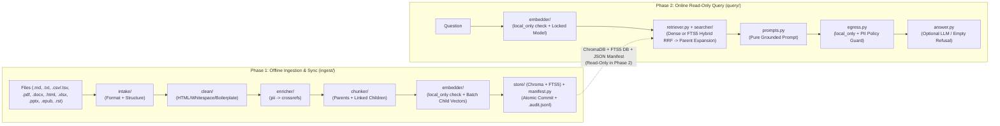

# Architecture & Internals

This document explains how **`docpipe-maestro`** processes documents from raw files to grounded answers, why each stage works the way it does, and how crash safety and exception preservation are enforced.

---

## 1. Two-Phase Pipeline Design

`docpipe-maestro` strictly separates offline index construction (**Phase 1**) from online read-only retrieval and optional generation (**Phase 2**):



### Module Layout & Phase Boundaries

Every file's execution role is visible from the package layout under `src/docpipe_maestro/`:

| Module | Phase | Responsibility |
|---|---|---|
| [`types.py`](../src/docpipe_maestro/types.py) | Shared | Single source of truth for chunks, metadata, profiles, `IngestContext`, manifest records, `PiiRecognizer`, `PiiPolicy`, `PiiBlockedError`, `PiiAuditRecord`, and `DocpipeError` hierarchy |
| [`config.py`](../src/docpipe_maestro/config.py) | Shared | Static constants (`DEFAULT_*`) and immutable chunking profiles (`DEFAULT`, `POLICY`, `resolve_profile`) |
| [`_registry.py`](../src/docpipe_maestro/_registry.py) | Shared | Lazy Strategy + Registry core with collision/lookup `RegistryError` guards |
| [`_crossrefs.py`](../src/docpipe_maestro/_crossrefs.py) | Shared | Phase-neutral cross-reference pattern matching, `index_section_targets`, `match_source_key`, and bounded excerpt truncation |
| [`_filters.py`](../src/docpipe_maestro/_filters.py) | Shared | Phase-neutral `where` filter parser, schema/operator validator, top-level manifest allowlist resolver, Chroma conjunction builder & SQLite SQL compiler |
| [`_pii.py`](../src/docpipe_maestro/_pii.py) | Shared | Phase-neutral PII policy validation, built-in/custom `PII_RECOGNIZERS`, HMAC tokenization (`tokenize_value`), and lazy multi-lang optional `[pii]` Presidio adapter |
| [`log.py`](../src/docpipe_maestro/log.py) | Shared | Phase-neutral, stdlib-only structured telemetry (`JsonFormatter`, `TextFormatter`, `get_logger` with `NullHandler`, `ContextVar` `correlation_id()`, and `stage_event` timing) |
| [`embedder/`](../src/docpipe_maestro/embedder/__init__.py) | Shared | Batched provider-agnostic embeddings via `litellm.embedding` (`batch_size=64`), `is_local_target` / `enforce_local_only`, offline `estimate_embedding_cost()`, and auth error normalization |
| [`manifest.py`](../src/docpipe_maestro/manifest.py) | Shared | Atomic DB-collocated JSON manifest (`sha256`, `mtime`/`size` fast-path, model lock) and owner-only `.audit.jsonl` writer |
| [`store/chroma.py`](../src/docpipe_maestro/store/chroma.py) | Shared | Embedded `chromadb.PersistentClient` wrapper (`cosine` space, `None` metadata bridge, staging cleanup) |
| [`store/_readonly.py`](../src/docpipe_maestro/store/_readonly.py) | Shared | Lazy stdlib SQLite URI (`?mode=ro` / `?mode=ro&immutable=1`) reader enabling `0`-byte immutable `reindex(..., dry_run=True)` previews without loading `chromadb` |
| [`store/lexical.py`](../src/docpipe_maestro/store/lexical.py) | Shared | Collocated SQLite FTS5 `LexicalIndex` (`unicode61` BM25, technical token sanitizer, strict `mode=ro` reads) |
| [`ingest/intake/`](../src/docpipe_maestro/ingest/intake/__init__.py) | Phase 1 | Format dispatch, magic-byte/ZIP-container hardening, core Markdown/Text/CSV/TSV, and lazy optional PDF/DOCX/HTML/XLSX/PPTX/EPUB/RST structural parsing |
| [`ingest/clean/`](../src/docpipe_maestro/ingest/clean/__init__.py) | Phase 1 | Allow-listed HTML stripping, whitespace normalization, and 3+ page header/footer boilerplate removal |
| [`ingest/enricher/`](../src/docpipe_maestro/ingest/enricher/__init__.py) | Phase 1 | Lazy `ENRICHERS` registry, pre-chunking `PiiEnricher` (`"pii"`), and `CrossrefsEnricher` (`"crossrefs"`); [`ingest/crossrefs.py`](../src/docpipe_maestro/ingest/crossrefs.py) stays as a compatibility re-export |
| [`ingest/chunker/`](../src/docpipe_maestro/ingest/chunker/__init__.py) | Phase 1 | Structure-aware parent sections & linked child chunks, offline token estimation, section-scoped overlap |
| [`ingest/pipeline.py`](../src/docpipe_maestro/ingest/pipeline.py) | Phase 1 | Public `ingest`, `sync` (including read-only `dry_run=True`), `remove`, `status`, and `reindex` (including read-only `dry_run=True`) orchestration syncing ChromaDB, FTS5, manifest, and transactional PII `.audit.jsonl` |
| [`query/searcher/`](../src/docpipe_maestro/query/searcher/__init__.py) | Phase 2 | Built-in `DenseSearcher` (`"default"`) and `Fts5HybridSearcher` (`"fts5_hybrid"` with RRF fusion) |
| [`query/reranker/`](../src/docpipe_maestro/query/reranker/__init__.py) | Phase 2 | Lazy `RERANKERS` registry, shared preflight validator, and optional `CrossEncoderReranker` (`"cross_encoder"`) |
| [`query/retriever.py`](../src/docpipe_maestro/query/retriever.py) | Phase 2 | Read-only child retrieval, `local_only` preflight, optional child-first reranking, parent expansion & cross-doc citation pass |
| [`query/prompts.py`](../src/docpipe_maestro/query/prompts.py) | Phase 2 | Pure zero-I/O prompt constructor preserving citation metadata (`Source`, `Section`, `Clause`, `Page`) |
| [`query/egress.py`](../src/docpipe_maestro/query/egress.py) | Phase 2 | Pre-network `--local-only` enforcement and outbound PII policy scrubbing/blocking across prompt strings and ChatML message arrays |
| [`query/answer.py`](../src/docpipe_maestro/query/answer.py) | Phase 2 | Optional grounded completion and pull-based synchronous streaming (`stream=True`) via `litellm.completion` guarded by `guard_egress()` with deterministic empty-context refusal |
| [`eval/`](../src/docpipe_maestro/eval/__init__.py) | Phase 2 | Read-only retrieval evaluation metrics (`metrics.py`) and harness runner (`harness.py`) with `local_only` preflight |
| [`cli.py`](../src/docpipe_maestro/cli.py) | Both | `docpipe-maestro` CLI entry point and **sole** module permitted to read TOML config (`--config`) or `--pii-policy` files |

---

## 2. Phase 1: Document Processing Stages

### Stage 1: Intake & Structure Extraction (`ingest/intake/`)

Supported extensions are core `.md`, `.markdown`, `.txt`, `.csv`, `.tsv` and optional `.html`, `.htm`, `.pdf`, `.docx`, `.xlsx`, `.pptx`, `.epub`, `.rst`. Legacy OLE2 binaries (`.doc`, `.xls`, `.ppt`) are rejected cleanly with `UnsupportedFormatError`. Files without an extension fall back to inspecting the leading 4 KiB (`head`):

1. **Binary magic bytes**:
   - `%PDF-` -> PDF (`pdf`)
   - `\xd0\xcf\x11\xe0\xa1\xb1\x1a\xe1` (OLE2 legacy binary) -> raises `UnsupportedFormatError`
   - `PK\x03\x04` -> validated in a single pass against the `256 MiB` uncompressed limit before inspecting inner markers: `word/document.xml` -> `docx`, `xl/workbook.xml` -> `xlsx`, `ppt/presentation.xml` -> `pptx`, `META-INF/container.xml` -> `epub`; other ZIP archives raise `UnsupportedFormatError`
   - Any `\x00` byte -> `UnsupportedFormatError`
2. **UTF-8 text sniffing**:
   - Decoding failures -> `UnsupportedFormatError`
   - Starts with `<!doctype html` or `<html` -> HTML (`html`)
   - Contains ATX Markdown headings (`#`–`######`) -> Markdown (`md`)
   - Otherwise -> Plain text (`txt`)

**Structural extraction rules per format:**

- **Markdown**: Tracks `` ``` `` and `~~~` fenced code blocks so `# comment` lines inside shell/Python snippets never split sections.
- **Plain Text & PDF**: Matches heuristic headings such as `Section 4: ...`, `Article II ...`, `Chapter 1`, `Part 3`, or `1. Capitalized Title`. Multi-page PDFs extract 1-based page numbers (`page`) and propagate the active heading state (`active_label`, `active_level`) into subsequent pages until a new heading appears.
- **CSV / TSV (`delimited.py`) & XLSX (`xlsx.py`)**: Enforce strict `utf-8-sig` decoding on `.csv`/`.tsv`, skip `hidden`/`veryHidden` Excel sheets and trailing empty columns, format scalar/cached formula cells against first-non-empty headers (`Header: Value` pairs, `Column N` fallback for ragged cells), and partition data rows into bounded 25-row sections (`<Source or Sheet> (Rows <start>-<end>)`). Blank-only or header-only files return `sections=[]` cleanly.
- **DOCX**: Walks `doc.element.body` children in document order so paragraphs and tables remain interleaved correctly; paragraphs styled `Heading 1`–`Heading 6` start sections, and table rows serialize as `cell1 | cell2 | ...`.
- **PPTX**: Iterates slides in order (`page = 1..N`), extracts slide titles (`Slide N` fallback), body paragraphs, grouped shapes recursively, table rows (` | `), and optional speaker notes while skipping empty slides.
- **HTML & EPUB**: HTML decomposes `<script>`, `<style>`, `<nav>`, `<footer>`, `<noscript>`, `<template>`, `<svg>`, and hidden DOM elements (`hidden`, `aria-hidden="true"`, `display:none`/`visibility:hidden`). EPUB validates the archive container, iterates ordered `ITEM_DOCUMENT` spine chapters (skipping `EpubNav`), and extracts sections cleanly using an offline hidden-DOM-stripping `HTMLParser` without requiring `beautifulsoup4`.
- **RST (`rst.py`)**: Enforces strict `utf-8-sig` decoding and offline doctree parsing (`file_insertion_enabled=False`, `raw_enabled=False`, warning suppression), mapping document/section titles into hierarchical sections (`heading_level`) with `"Introduction"` fallback for headingless prose while ignoring system-warning/comment/raw nodes.

Empty container headings (e.g., `## 7. Requirements` followed immediately by `### 7.1 Scope` with no intervening prose) are omitted so zero-content parent sections are not indexed; if a file yields no sections at all, non-empty text falls back to a single section.

### Stage 2: Text Cleaning (`ingest/clean.py`)

`clean_text()` normalizes line endings (`\r\n`/`\r` -> `\n`), collapses horizontal whitespace (`[ \t\f\v]+`), and reduces 3+ consecutive newlines to `\n\n`.

Importantly, `_TAG_RE` matches **only recognized HTML tag names and `<!--...-->` comments** rather than any `<...>` sequence. This preserves mathematical inequalities (such as `hours > 15 and tenure < 90`) and documentation placeholders (`<collection>.json`, `<uuid>`).

`clean_document()` inspects the first and last non-empty normalized line on every paginated page: if 3 or more distinct pages share the exact same normalized first or last line, that line is removed across all sections as recurring page-header/footer boilerplate.

### Stage 3: Document Enrichers & Cross-Reference Resolution (`ingest/enricher/`)

`ingest()` and `sync()` resolve every configured name in `profile.enrichers` upfront from `ENRICHERS` (failing immediately with `RegistryError` if any entry is missing) and execute them sequentially in declared order between cleaning and chunking, passing each stage the per-document `IngestContext` (`collection`, `source`, `content_hash`, `doc_version`, `embed_model`, `profile`). On `DEFAULT` (`enrichers=()`), zero enrichers are resolved or invoked.

When `profile.enrichers` includes `"crossrefs"` (`POLICY` sets `enrichers=("crossrefs",)`, and legacy custom profiles setting `resolve_crossrefs=True` with empty `enrichers` normalize automatically to `("crossrefs",)`), `CrossrefsEnricher` runs `resolve_crossrefs(doc)` backed by shared helpers in [`_crossrefs.py`](../src/docpipe_maestro/_crossrefs.py):

1. `index_section_targets(...)` indexes every section heading containing a numeric identifier (`Section 7`, `Article 4`, `7.5 Public API`, `20.2: Compliance Rules`, `4. Regional Caps`) as well as multi-part numbered clause lines (`1.1`, `2.3.1`, etc.).
   - Bare integer headings without a prefix require a trailing dot (`4. Title`) so headings such as `2026 Roadmap` or `3.5mm Audio Hardware` are not misindexed as `Section 2026` or `§3.5`.
2. Each section's `raw_text` is scanned once (non-recursively) for `Section <num>`, `Article <num>`, `Clause <num>`, or `§<num>`.
3. References matching the current section's own identifier (`self_keys`) or already resolved in the same section are skipped, preventing infinite mutual recursion (`Section 1` $\leftrightarrow$ `§2.1`).
4. Resolved targets are truncated cleanly at a word boundary (`max_chars=400`) and appended as `[Crossref <ref>: <excerpt>]`. Unresolved references (such as external statutes or skipped empty container headings) emit a structured `WARNING` log via `docpipe_maestro.ingest.enricher.crossrefs` and are never silently lost.

### Stage 4: Structure-Aware Hierarchical Chunking (`ingest/chunker.py`)

Each cleaned `ParsedSection` becomes **one `"parent"` section chunk** (`parent_id=None`) and **one or more `"child"` chunks** (`parent_id=<parent.id>`):

- **Offline Token Estimation**: `estimate_tokens(text)` uses `max(1, (words * 4 + 2) // 3)` (if non-empty), avoiding runtime `tiktoken` network fetches in air-gapped environments.
- **Clause Detection**: Recognizes `Clause X`, `Article X`, `Section X`, `§X`, `1.2`, `1.2.3`, and `(a)` list markers.
- **Clause Preservation (`POLICY`)**: Individual clauses stay whole even when a single clause exceeds `chunk_size` tokens.
- **Fallback Splitting (`DEFAULT`)**: Blocks exceeding `chunk_size` split via LangChain's `RecursiveCharacterTextSplitter` across `["\n\n", "\n", ". ", " ", ""]`.
- **Section-Scoped Overlap**: Consecutive child chunks inside the same parent carry trailing words up to `profile.overlap` tokens *if and only if* prepending the overlap still fits within `chunk_size`. Overlap resets cleanly at every section boundary.
- **Provenance Header**: Every child chunk text begins with `[Source: <source> | Section: <section>]` (plus `| Clause: <clause>` when detected), ensuring every embedded vector carries document and section identity.
- **Content-Addressed IDs**: `make_chunk_id()` computes a 16-character SHA-256 hex digest over `source`, `doc_version`, `type`, `parent_id`, `section`, `clause`, `chunk_index`, and `text`.

---

## 3. Storage, Synchronization & Crash Safety

### Vector & Lexical Storage Model (`store/chroma.py`, `store/lexical.py`)

For child/parent retrieval, ChromaDB stores both `"child"` and `"parent"` records in a single collection (`hnsw:space: cosine`), while `LexicalIndex` maintains a collocated SQLite FTS5 index (`<persist_dir>/lexical/<collection>.db`, `tokenize='unicode61'`) over child chunks (with section weight `1.5`, clause weight `2.0`, content weight `1.0`):

| Field / Record Type | `metadata["type"]` | `parent_id` | Stored Vector | Searchable? |
|---|---|---|---|---|
| **Child chunk** | `"child"` | `<parent.id>` | Dense vector from `embed_model` | **Yes** (dense `where={"type": "child"}` & FTS5 `chunks_fts`) |
| **Parent section** | `"parent"` | *(omitted -> `None`)* | Zero placeholder `[0.0] * dim` | **No** (fetched only by ID) |

- **Null Metadata Bridge**: ChromaDB rejects `None` metadata values; `_serialize_metadata()` omits `clause`, `page`, and `parent_id` when `None`, and `_deserialize_metadata()` restores `None` on read.
- **Similarity Normalization**: Under `"default"`, Chroma cosine distance (`1 - cosine_similarity`) is clamped onto `[0.0, 1.0]`. Under `"fts5_hybrid"`, Reciprocal Rank Fusion (`k = 60`, weights `0.5` / `0.5`) divides raw RRF by the theoretical maximum `1 / 61` onto `[0.0, 1.0]` (`1.0` for rank-1 in both signals; `<= 0.5` for single-signal matches).

### Crash-Safe Transactional Update Protocol (`manifest.py`, `pipeline.py`)

Never mutating stores via partial ID-only upserts prevents orphaned clauses when edited files shrink:

```text
1. Inspect Disk & Manifest (mtime/size fast-path -> sha256 check)
2. Atomic Batch Validation:
   Parse -> Clean -> Enrich (pii pre-chunking -> crossrefs) -> Chunk -> Embed ALL changed files in memory
   (Any format error, missing extra, PiiBlockedError, enricher failure, or provider/auth failure aborts BEFORE DB init;
    on PiiBlockedError only the offending source emits one blocked=True record to <collection>.audit.jsonl)
3. Open VectorStore + LexicalIndex & sweep_uncommitted(active_versions) from prior interrupted runs
4. Per changed source document:
   a. Stage new child/parent records in ChromaDB and child rows in SQLite FTS5 tagged with doc_version = sha256_hex[:12]
   b. Atomically write manifest (<persist_dir>/manifests/<collection>.json)
      via tempfile.mkstemp -> flush -> os.fsync -> os.replace
   c. When pii_policy is active, append one blocked=False record to <persist_dir>/manifests/<collection>.audit.jsonl (0o700 dir / 0o600 file, zero raw PII)
   d. Delete prior doc_version rows from both ChromaDB and SQLite FTS5
```

If the process crashes between steps `4a` and `4b`:
- Phase 2 `retrieve()` verifies every candidate chunk's `(source, doc_version)` against the committed manifest (both in dense `Store` and read-only SQLite URI `mode=ro` in `LexicalIndex`), ignoring uncommitted records so the prior version stays 100% queryable.
- The next Phase 1 run invokes `sweep_uncommitted()` across both stores to clean up uncommitted debris.

### Model Lock & Self-Exclusion

- **Embedding Model Lock**: Once committed, `manifest.embed_model` locks the collection. Calling `ingest`, `sync`, or `retrieve` with a different `embed_model` raises `ModelMismatchError` until `reindex(embed_model=...)` re-embeds all stored children and updates parent zero-vector dimensions.
- **Empty-File Dimension Safety**: In multi-file batches where an empty (0-chunk) file sorts before non-empty documents, `manifest.embed_dim` only locks when `dim > 0`.
- **Self-Ingestion Protection**: When `persist_dir` lives inside the target directory being ingested or synced, `_discover_files()` excludes files under `persist_path`.

---

## 4. Phase 2: Exception Preservation & "Search Small, Return Big"

```text
Question ──► validate & resolve `where` (`_filters.py`: chunk fields + manifest profile/dates; [] short-circuit if empty)
         ──► searcher (Dense or FTS5 Hybrid RRF) over committed child chunks (`type="child"` $and user where)
             (child_top_k = max(rerank_top_n, top_k * 3) if rerank & expand_parent)
                                     │
                                     ▼ (filter uncommitted doc_version & Stage 1 score >= threshold)
                                [rerank=True?]
                                     │ yes ──► reranker (CrossEncoder sigmoid [0.0, 1.0] over children)
                                     ▼
                          ┌──────────┴──────────┐
               expand_parent=True      expand_parent=False
                          │                     │
                          ▼                     ▼
             Deduplicate parent_ids       Return sorted
             score = max(child.score)      child chunks
             Fetch parents via get_by_ids()
             Return sorted desc by score
```

In policy and compliance corpora, an isolated sentence such as *"Full-time employees receive 20 days of annual leave"* can become **factually inverted** without its nearby exception (*"except during the initial 90-day probationary period"*). Combining:
1. `POLICY` clause indivisibility (`clause_preserving=True`),
2. Intra-document cross-reference resolution (`enrichers=("crossrefs",)` / `resolve_crossrefs=True`), and
3. Parent-section expansion (`expand_parent=True`)

ensures matched child clauses bring their complete enclosing rules and exceptions into context — continuously verified by the mandatory Release Gate in [`tests/test_reverse_safety.py`](../tests/test_reverse_safety.py).

`build_prompt(question, sections)` formats retrieved context strictly offline with source/section/clause/page citations, and `answer(..., has_context=bool(sections))` short-circuits immediately with `"Not found in the provided context."` (returning the refusal string when `stream=False`, or yielding it once with zero LiteLLM calls when `stream=True`) when retrieval yields no qualifying sections.

For longitudinal quality measurement, [`docpipe_maestro.eval`](../src/docpipe_maestro/eval/__init__.py) evaluates Phase 2 `retrieve()` outputs strictly read-only: `evaluate()` verifies manifest presence, embedding model locks, and committed sources prior to store instantiation so missing collections create zero storage artifacts and valid runs produce `0`-byte persistence drift.

---

## 5. Structured JSON Telemetry & Correlation Tracing (`log.py`)

`docpipe-maestro` provides opt-in, PII-safe structured telemetry through [`src/docpipe_maestro/log.py`](../src/docpipe_maestro/log.py) while upholding strict **Library Purity**:

- **Passive Library Default**: `get_logger()` attaches only a silent `logging.NullHandler` onto the `"docpipe_maestro"` package logger. Calling library entry points never configures or alters the host application's root logger, never writes unsolicited text to `stdout` or `stderr`, and never overrides explicit log thresholds. When no handler matches an event's severity, `stage_event()` short-circuits cleanly via `logger.isEnabledFor(...)`.
- **Execution-Context Correlation**: All Phase 1 entry points (`ingest`, `sync`, `remove`, `status`, `reindex`), Phase 2 entry points (`retrieve`, `answer_detailed`, `evaluate`), and CLI subcommand dispatches open an async-safe and thread-safe `ContextVar`-backed `correlation_id()` scope. Active outer identifiers are inherited automatically so multi-step operations (such as CLI `ask`, `eval`, or `reindex`) share one UUID `correlation_id` and restore state cleanly in `finally`.
- **Single-Line JSON Envelope**: `JsonFormatter` renders `{ts, level, logger, msg, correlation_id, fields}` where `ts` is UTC ISO-8601, `correlation_id` is `null` outside active scopes, and all stage attributes live nested inside `fields` (preventing reserved envelope key overwrites) with safe `os.PathLike`/`set`/`tuple` coercion.
- **Canonical Stage Events (`msg = "stage.end"`)**:
  - **Phase 1**: `ingest()` and `sync()` emit batch-scoped `INFO` summaries for `intake`, `clean`, `enrich`, `chunk`, `embed`, and `store` (including `docs=0` no-change runs) plus per-document `DEBUG` events for `intake`, `clean`, `enrich`, and `chunk`; `sync(..., dry_run=True)` omits `embed` and emits a read-only `store` preview (`dry_run=True`). Live `reindex()` emits `embed` + `store`, while `reindex(..., dry_run=True)`, `remove()`, and `status()` emit `store`.
  - **Phase 2**: `retrieve()` emits `embed` (post-short-circuit), `search`, and conditional `rerank`; `guard_egress()` emits `egress` when active remote PII inspection runs; `answer_detailed()` and `answer(..., stream=True)` emit `answer` (including `stream=True` and `closed_early=True` on early iterator closure, without logging raw tokens or prompts) when completion runs (`has_context=True`).
- **Privacy & Failure Hygiene**: Both `JsonFormatter` and standalone `TextFormatter` strip `exc_info`/`exc_text` tracebacks. On stage failure, `stage_event()` emits an `ERROR` `stage.end` event recording only `duration_ms`, `status="error"`, and `error_type` (exception class name) before re-raising. Raw documents, chunks, questions, prompts, answers, synthetic/live PII, raw exception messages, and API credentials are never emitted at `INFO` or `DEBUG`.

```python
import logging
from docpipe_maestro.log import JsonFormatter, get_logger

logger = get_logger()
handler = logging.StreamHandler()
handler.setFormatter(JsonFormatter())
logger.addHandler(handler)
logger.setLevel(logging.INFO)
```
