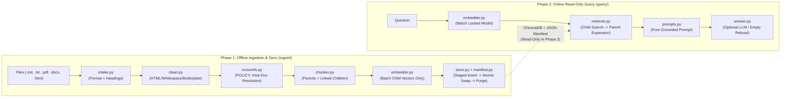

# Architecture & Internals

This document explains how **`docpipe-maestro`** processes documents from raw files to grounded answers, why each stage works the way it does, and how crash safety and exception preservation are enforced.

---

## 1. Two-Phase Pipeline Design

`docpipe-maestro` strictly separates offline index construction (**Phase 1**) from online read-only retrieval and optional generation (**Phase 2**):



### Module Layout & Phase Boundaries

Every file's execution role is visible from the package layout under `src/docpipe_maestro/`:

| Module | Phase | Responsibility |
|---|---|---|
| [`types.py`](../src/docpipe_maestro/types.py) | Shared | Single source of truth for chunks, metadata, profiles, manifest records, results, and `DocpipeError` hierarchy |
| [`config.py`](../src/docpipe_maestro/config.py) | Shared | Static constants (`DEFAULT_*`) and immutable chunking profiles (`DEFAULT`, `POLICY`, `resolve_profile`) |
| [`embedder.py`](../src/docpipe_maestro/embedder.py) | Shared | Batched provider-agnostic embeddings via `litellm.embedding` (`batch_size=64`) and auth error normalization |
| [`manifest.py`](../src/docpipe_maestro/manifest.py) | Shared | Atomic DB-collocated JSON manifest (`sha256`, `mtime`/`size` fast-path, collection model lock) |
| [`store.py`](../src/docpipe_maestro/store.py) | Shared | Embedded `chromadb.PersistentClient` wrapper (`cosine` space, `None` metadata bridge, staging cleanup) |
| [`ingest/intake.py`](../src/docpipe_maestro/ingest/intake.py) | Phase 1 | Format dispatch, magic-byte fallback, fenced-block-safe Markdown, PDF/DOCX/HTML structural parsing |
| [`ingest/clean.py`](../src/docpipe_maestro/ingest/clean.py) | Phase 1 | Allow-listed HTML stripping, whitespace normalization, and 3+ page header/footer boilerplate removal |
| [`ingest/crossrefs.py`](../src/docpipe_maestro/ingest/crossrefs.py) | Phase 1 | Intra-document `Section`/`Article`/`Clause`/`§` detection, cycle-safe excerpt injection, unresolved warnings |
| [`ingest/chunker.py`](../src/docpipe_maestro/ingest/chunker.py) | Phase 1 | Structure-aware parent sections & linked child chunks, offline token estimation, section-scoped overlap |
| [`ingest/pipeline.py`](../src/docpipe_maestro/ingest/pipeline.py) | Phase 1 | Public `ingest`, `sync`, `remove`, `status`, and `reindex` orchestration with atomic batch staging |
| [`query/retriever.py`](../src/docpipe_maestro/query/retriever.py) | Phase 2 | Read-only child similarity search, `doc_version` guard, threshold filter, parent expansion & dedup |
| [`query/prompts.py`](../src/docpipe_maestro/query/prompts.py) | Phase 2 | Pure zero-I/O prompt constructor preserving citation metadata (`Source`, `Section`, `Clause`, `Page`) |
| [`query/answer.py`](../src/docpipe_maestro/query/answer.py) | Phase 2 | Optional grounded completion via `litellm.completion` with deterministic empty-context refusal |
| [`cli.py`](../src/docpipe_maestro/cli.py) | Both | `docpipe` CLI entry point and **sole** module permitted to read user TOML config files (`--config`) |

---

## 2. Phase 1: Document Processing Stages

### Stage 1: Intake & Structure Extraction (`ingest/intake.py`)

Supported extensions are `.md`, `.markdown`, `.txt`, `.html`, `.htm`, `.pdf`, and `.docx`. Files without an extension fall back to inspecting the first 4 KiB (`head`):

1. **Binary magic bytes**:
   - `%PDF-` -> PDF (`pdf`)
   - `PK\x03\x04` containing `word/document.xml` -> DOCX (`docx`); other ZIP archives raise `UnsupportedFormatError`
   - Any `\x00` byte -> `UnsupportedFormatError`
2. **UTF-8 text sniffing**:
   - Decoding failures -> `UnsupportedFormatError`
   - Starts with `<!doctype html` or `<html` -> HTML (`html`)
   - Contains ATX Markdown headings (`#`–`######`) -> Markdown (`md`)
   - Otherwise -> Plain text (`txt`)

**Structural extraction rules per format:**

- **Markdown**: Tracks `` ``` `` and `~~~` fenced code blocks so `# comment` lines inside shell/Python snippets never split sections.
- **Plain Text & PDF**: Matches heuristic headings such as `Section 4: ...`, `Article II ...`, `Chapter 1`, `Part 3`, or `1. Capitalized Title`. Multi-page PDFs extract 1-based page numbers (`page`) and propagate the active heading state (`active_label`, `active_level`) into subsequent pages until a new heading appears.
- **DOCX**: Walks `doc.element.body` children in document order so paragraphs and tables remain interleaved correctly; paragraphs styled `Heading 1`–`Heading 6` start sections, and table rows serialize as `cell1 | cell2 | ...`.
- **HTML**: Decomposes `<script>`, `<style>`, `<nav>`, `<footer>`, and `<noscript>` first, ignores HTML comments, starts sections at `<h1>`–`<h6>`, flattens `<tr>` rows with ` | `, and traverses nested containers (`div`, `section`, `article`, `main`, `aside`, `header`, lists) without duplicating child blocks.

Empty container headings (e.g., `## 7. Requirements` followed immediately by `### 7.1 Scope` with no intervening prose) are omitted so zero-content parent sections are not indexed; if a file yields no sections at all, non-empty text falls back to a single section.

### Stage 2: Text Cleaning (`ingest/clean.py`)

`clean_text()` normalizes line endings (`\r\n`/`\r` -> `\n`), collapses horizontal whitespace (`[ \t\f\v]+`), and reduces 3+ consecutive newlines to `\n\n`.

Importantly, `_TAG_RE` matches **only recognized HTML tag names and `<!--...-->` comments** rather than any `<...>` sequence. This preserves mathematical inequalities (such as `hours > 15 and tenure < 90`) and documentation placeholders (`<collection>.json`, `<uuid>`).

`clean_document()` inspects the first and last non-empty normalized line on every paginated page: if 3 or more distinct pages share the exact same normalized first or last line, that line is removed across all sections as recurring page-header/footer boilerplate.

### Stage 3: Intra-Document Cross-Reference Resolution (`ingest/crossrefs.py`)

When `profile.resolve_crossrefs=True` (`POLICY` profile):

1. `_build_target_index(doc)` indexes every section heading containing a numeric identifier (`Section 7`, `Article 4`, `7.5 Public API`, `20.2: Compliance Rules`, `4. Regional Caps`) as well as multi-part numbered clause lines (`1.1`, `2.3.1`, etc.).
   - Bare integer headings without a prefix require a trailing dot (`4. Title`) so headings such as `2026 Roadmap` or `3.5mm Audio Hardware` are not misindexed as `Section 2026` or `§3.5`.
2. Each section's `raw_text` is scanned once (non-recursively) for `Section <num>`, `Article <num>`, `Clause <num>`, or `§<num>`.
3. References matching the current section's own identifier (`self_keys`) or already resolved in the same section are skipped, preventing infinite mutual recursion (`Section 1` $\leftrightarrow$ `§2.1`).
4. Resolved targets are truncated cleanly at a word boundary (`max_chars=400`) and appended as `[Crossref <ref>: <excerpt>]`. Unresolved references (such as external statutes or skipped empty container headings) emit a structured `WARNING` log via `docpipe_maestro.ingest.crossrefs` and are never silently lost.

### Stage 4: Structure-Aware Hierarchical Chunking (`ingest/chunker.py`)

Each cleaned `ParsedSection` becomes **one `"parent"` section chunk** (`parent_id=None`) and **one or more `"child"` chunks** (`parent_id=<parent.id>`):

- **Offline Token Estimation**: `estimate_tokens(text)` uses `max(1, (words * 4 + 2) // 3)` (if non-empty), avoiding runtime `tiktoken` network fetches in air-gapped environments.
- **Clause Detection**: Recognizes `Clause X`, `Article X`, `Section X`, `§X`, `1.2`, `1.2.3`, and `(a)` list markers.
- **Clause Preservation (`POLICY`)**: Individual clauses stay whole even when a single clause exceeds `chunk_size` tokens.
- **Fallback Splitting (`DEFAULT`)**: Blocks exceeding `chunk_size` split via LangChain's `RecursiveCharacterTextSplitter` across `["\n\n", "\n", ". ", " ", ""]`.
- **Section-Scoped Overlap**: Consecutive child chunks inside the same parent carry trailing words up to `profile.overlap` tokens *if and only if* prepending the overlap still fits within `chunk_size`. Overlap resets cleanly at every section boundary.
- **Provenance Header**: Every child chunk text begins with `[Source: <source> | Section: <section>]` (plus `| Clause: <clause>` when detected), ensuring every embedded vector carries document and section identity.
- **Content-Addressed IDs**: `make_chunk_id()` computes a 16-character SHA-256 hex digest over `source`, `doc_version`, `type`, `parent_id`, `section`, `clause`, `chunk_index`, and `text`.

---

## 3. Storage, Synchronization & Crash Safety

### Single-Collection Storage Model (`store.py`)

For v0.1, child chunks and parent sections live in a single embedded ChromaDB collection configured with `hnsw:space: cosine`:

| Field / Record Type | `metadata["type"]` | `parent_id` | Stored Vector | Searchable? |
|---|---|---|---|---|
| **Child chunk** | `"child"` | `<parent.id>` | Dense vector from `embed_model` | **Yes** (`where={"type": "child"}`) |
| **Parent section** | `"parent"` | *(omitted -> `None`)* | Zero placeholder `[0.0] * dim` | **No** (fetched only by ID) |

- **Null Metadata Bridge**: ChromaDB rejects `None` metadata values; `_serialize_metadata()` omits `clause`, `page`, and `parent_id` when `None`, and `_deserialize_metadata()` restores `None` on read.
- **Similarity Normalization**: Chroma cosine distance (`1 - cosine_similarity`) is clamped onto `[0.0, 1.0]` as `score = max(0.0, min(1.0, 1.0 - distance))` where higher means closer match.

### Crash-Safe Transactional Update Protocol (`manifest.py`, `pipeline.py`)

Never mutating ChromaDB via partial ID-only upserts prevents orphaned clauses when edited files shrink:

```text
1. Inspect Disk & Manifest (mtime/size fast-path -> sha256 check)
2. Atomic Batch Validation:
   Parse -> Clean -> Crossref -> Chunk -> Embed ALL changed files in memory
   (Any format error, missing extra, or provider/auth failure aborts BEFORE DB init)
3. Open VectorStore & sweep_uncommitted(active_versions) from prior interrupted runs
4. Per changed source document:
   a. Add new records tagged with doc_version = sha256_hex[:12]
   b. Atomically write manifest (<persist_dir>/manifests/<collection>.json)
      via tempfile.mkstemp -> flush -> os.fsync -> os.replace
   c. store.delete_stale_versions(source, doc_version)
```

If the process crashes between steps `4a` and `4b`:
- Phase 2 `retrieve()` verifies every candidate chunk's `(source, doc_version)` against the committed manifest (and over-fetches `2x` during `query_children`), ignoring uncommitted records so the prior version stays 100% queryable.
- The next Phase 1 run invokes `sweep_uncommitted()` to clean up uncommitted debris.

### Model Lock & Self-Exclusion

- **Embedding Model Lock**: Once committed, `manifest.embed_model` locks the collection. Calling `ingest`, `sync`, or `retrieve` with a different `embed_model` raises `ModelMismatchError` until `reindex(embed_model=...)` re-embeds all stored children and updates parent zero-vector dimensions.
- **Empty-File Dimension Safety**: In multi-file batches where an empty (0-chunk) file sorts before non-empty documents, `manifest.embed_dim` only locks when `dim > 0`.
- **Self-Ingestion Protection**: When `persist_dir` lives inside the target directory being ingested or synced, `_discover_files()` excludes files under `persist_path`.

---

## 4. Phase 2: Exception Preservation & "Search Small, Return Big"

```text
Question ──► embed_query() ──► query_children(where={"type": "child"}, top_k)
                                     │
                                     ▼ (filter uncommitted doc_version & score >= threshold)
                          ┌──────────┴──────────┐
               expand_parent=True      expand_parent=False
                          │                     │
                          ▼                     ▼
             Deduplicate parent_ids       Return sorted
             score = max(child.score)      child chunks
             Fetch parents via get_by_ids()
             Return sorted desc by score
```

In policy and compliance corpora, an isolated sentence such as *"Full-time employees receive 20 days of annual leave"* can become **factually inverted** without its nearby exception (*"except during the initial 90-day probationary period"*). Combining:
1. `POLICY` clause indivisibility (`clause_preserving=True`),
2. Intra-document cross-reference resolution (`resolve_crossrefs=True`), and
3. Parent-section expansion (`expand_parent=True`)

ensures matched child clauses bring their complete enclosing rules and exceptions into context — continuously verified by the mandatory Release Gate in [`tests/test_reverse_safety.py`](../tests/test_reverse_safety.py).

`build_prompt(question, sections)` formats retrieved context strictly offline with source/section/clause/page citations, and `answer(..., has_context=bool(sections))` short-circuits immediately with `"Not found in the provided context."` when retrieval yields no qualifying sections.
